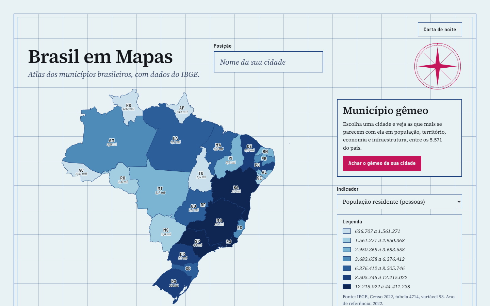
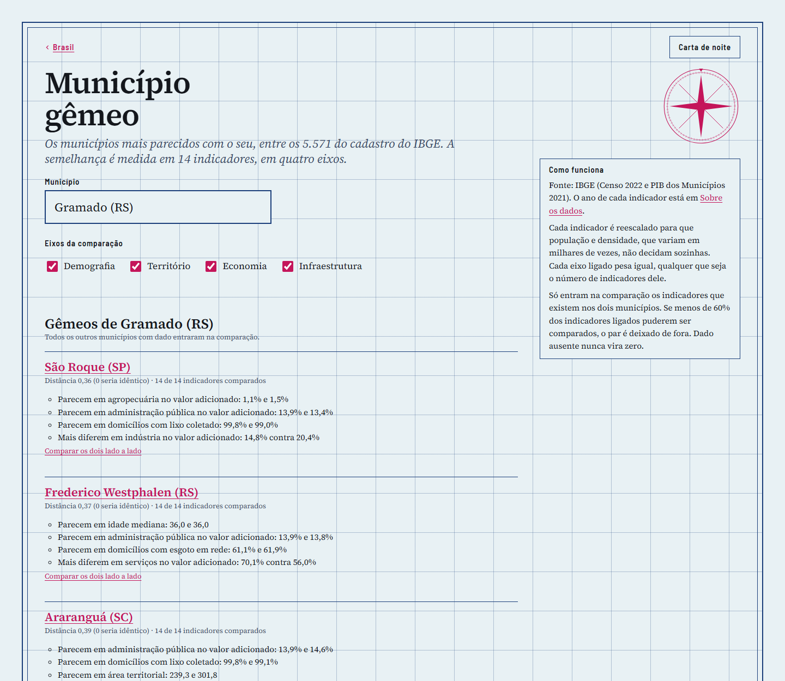
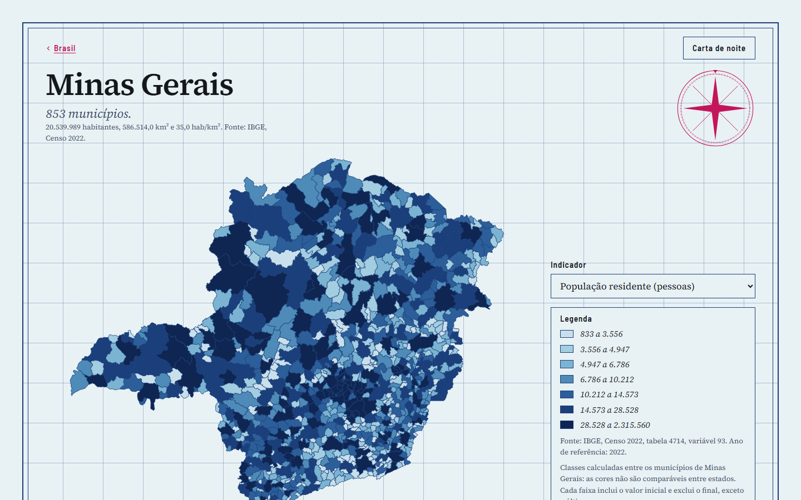
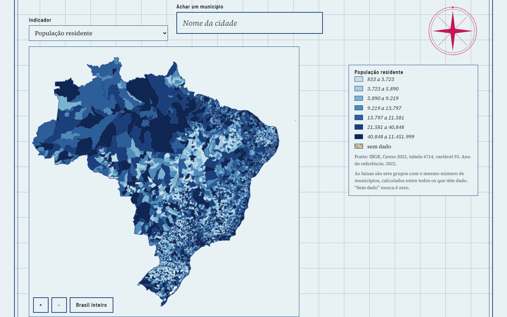
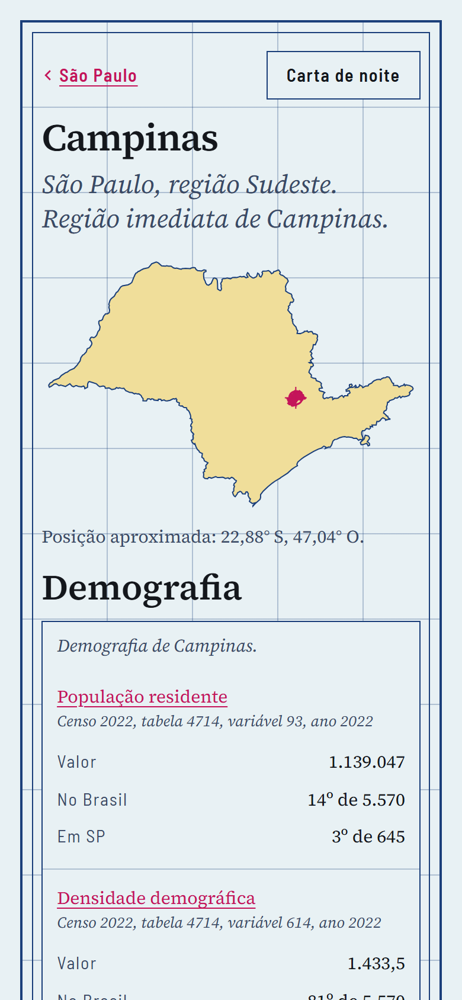
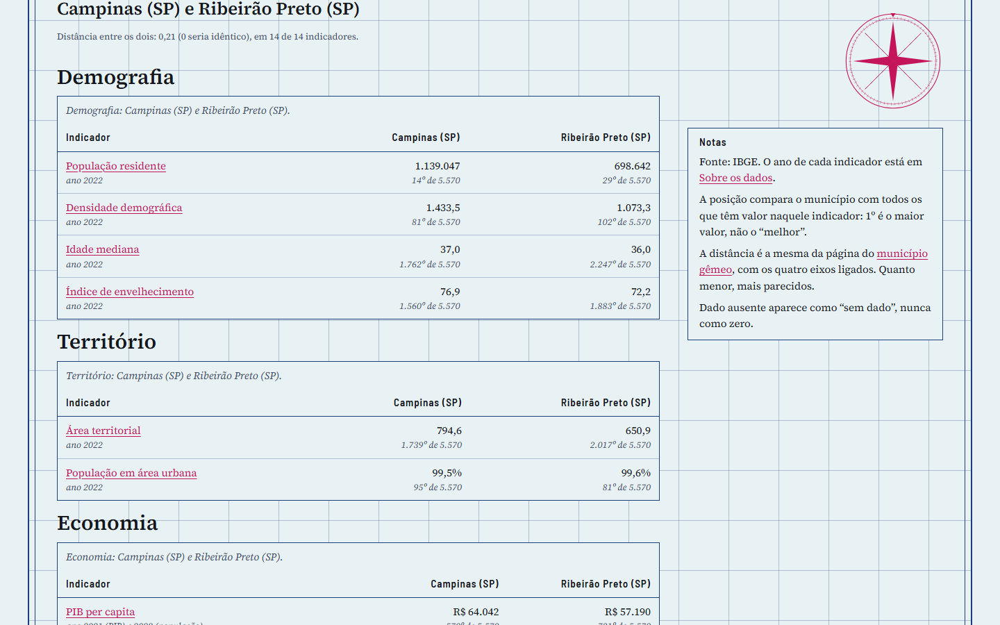

# Brasil em Mapas

Atlas interativo dos 5.570 municípios brasileiros, feito com dados públicos do IBGE. A pergunta central é: **qual município se parece mais com o seu?**

**[Abrir o site → brasilemmapas.vercel.app](https://brasilemmapas.vercel.app)**

<picture>
  <source media="(prefers-color-scheme: dark)" srcset="docs/images/home-dark.png">
  
</picture>

Site 100% estático (Astro), sem servidor, sem banco de dados, sem chave de API e sem custo. As imagens seguem o tema do seu GitHub: o site tem tema claro ("carta de dia") e escuro ("carta de noite").

## O município gêmeo

Escolha uma cidade e o atlas mostra as mais parecidas com ela em 14 indicadores do IBGE, em quatro eixos que você liga e desliga: demografia, território, economia e infraestrutura. Cada gêmeo vem com o porquê: os indicadores em que os dois mais se parecem e o que mais os separa.

<picture>
  <source media="(prefers-color-scheme: dark)" srcset="docs/images/gemeo-dark.png">
  
</picture>

## Telas

**Estado**: o mapa de cada município do estado, com legenda e a mesma informação em tabela.

<picture>
  <source media="(prefers-color-scheme: dark)" srcset="docs/images/estado-dark.png">
  
</picture>

**Brasil inteiro**: os 5.570 municípios num só mapa em canvas, com zoom e busca, carregado só quando pedido.

<picture>
  <source media="(prefers-color-scheme: dark)" srcset="docs/images/brasil-dark.png">
  
</picture>

<table>
  <tr>
    <td width="34%" valign="top">
      <strong>Município</strong>: cada indicador com valor, fonte, ano e posição no Brasil e no estado. Funciona sem JavaScript.
      <br><br>
      <picture>
        <source media="(prefers-color-scheme: dark)" srcset="docs/images/municipio-dark.png">
        
      </picture>
    </td>
    <td width="66%" valign="top">
      <strong>Comparar</strong>: duas cidades lado a lado, indicador por indicador, com a distância entre elas.
      <br><br>
      <picture>
        <source media="(prefers-color-scheme: dark)" srcset="docs/images/comparar-dark.png">
        
      </picture>
    </td>
  </tr>
</table>

## Feito com

Astro (saída estática) e TypeScript estrito; D3 (projeção e escalas) e TopoJSON nos mapas; Pagefind na busca; Satori nas imagens de compartilhamento; GSAP em animações curtas; Zod para validar cada resposta do IBGE. Testes com Vitest, Playwright e axe-core. Publicado na Vercel.

## O que tem

| Rota | O que faz |
|---|---|
| `/` | Mapa do Brasil por estado, busca de cidade e entrada para o resto |
| `/uf/[sigla]/` | Mapa municipal do estado, legenda e tabela com todos os municípios |
| `/municipio/[slug]/` | 14 indicadores em quatro eixos, posição no Brasil e no estado, nomes mais comuns |
| `/gemeo/` | Os municípios mais parecidos com o escolhido, com os eixos que você liga e desliga e uma explicação de cada par |
| `/comparar/?a=…&b=…` | Dois municípios lado a lado |
| `/ranking/[indicador]/` | Os 25 maiores e os 25 menores de cada indicador |
| `/brasil/` | Os 5.570 municípios num só mapa (canvas), com zoom, carregado sob demanda |
| `/sobre/` | Fontes, anos de referência e como ler "sem dado" |

Cada número traz a fonte (IBGE) e o ano de referência. Dado ausente aparece como **"sem dado"**, nunca como zero nem como estimativa.

## Como o gêmeo é calculado

Em `src/lib/twin.ts`, no navegador, a partir de uma matriz de 5.571 × 14 números:

1. `log1p` nos indicadores de cauda longa (população, densidade, área, PIB per capita, renda per capita, envelhecimento), depois z-score robusto (mediana e MAD), com os valores cortados em ±4.
2. Cada eixo ligado pesa igual, qualquer que seja o número de indicadores dele.
3. Distância euclidiana ponderada só nos indicadores presentes nos dois municípios. Se menos de 60% dos indicadores ligados puderem ser comparados, o par é deixado de fora e a página diz isso.
4. Para cada gêmeo, os 3 indicadores mais parecidos e o que mais diverge.

Os detalhes e os porquês estão em [docs/DECISIONS.md](docs/DECISIONS.md) (D5.x).

## Comandos

Node 24 (`.nvmrc`) e npm.

```bash
npm install
npm run dev          # http://localhost:4321
npm run build        # build de produção em dist/ + índice de busca do Pagefind
npm run preview      # serve o build
npm run check        # astro check (tipos) + ESLint
npm test             # Vitest (lógica de src/lib/)
npm run test:e2e     # Playwright (inclui axe-core, acessibilidade, em tema claro e escuro)
npm run data:fetch   # baixa e processa os dados do IBGE para src/data/
```

`npm run data:fetch` só é preciso para atualizar os dados. Os arquivos processados de `src/data/` estão no repositório, então o build nunca depende do IBGE estar no ar. O navegador de quem visita também nunca fala com o IBGE.

## Dados

- APIs do IBGE: localidades v1, malhas v3, agregados v3 e nomes v2 (`servicodados.ibge.gov.br`).
- `scripts/fetch-data.ts` baixa para `data/raw/` (cache, fora do git), valida cada resposta com um schema Zod e grava `src/data/`: municípios, UFs, a matriz de indicadores (`indicadores.bin`, Float32, `NaN` = sem dado), nomes do Censo 2010 e as malhas em TopoJSON.
- Código de município tem 7 dígitos e é sempre `string`. O slug é `nome-uf` sem acento (`bom-jesus-pi`), porque há nomes repetidos entre estados.
- Fontes e anos: Censo 2022 (população, área, idade, renda, saneamento), PIB dos Municípios 2021, Censo 2010 (nomes). Lista completa em `/sobre/`.

## Estrutura

```
src/lib/       funções puras (normalização, distância do gêmeo, rankings, classes do mapa, zoom), cada uma com teste
src/pages/     rotas; /dados/ serve a matriz e as malhas como arquivos estáticos do próprio site
src/scripts/   ilhas de JavaScript (mapa, busca, gêmeo, comparar, mapa nacional)
src/data/      dados processados do IBGE (grandes: não abra inteiros, use jq, head ou um script)
src/styles/    tokens.css (cores, tipografia, espaçamento; tema claro e escuro) e atlas.css
e2e/           testes de ponta a ponta
docs/          PLAN.md (fases) e DECISIONS.md (toda decisão não óbvia, com números medidos)
```

## Acessibilidade e desempenho

- Todo mapa tem alternativa em tabela ou lista navegável por teclado e leitor de tela. Regiões roláveis são focáveis.
- O `axe-core` roda nas páginas principais, nos temas claro e escuro, em 375 px e 1440 px (`e2e/a11y.spec.ts`).
- Animações curtas (até 600 ms) com GSAP, só em conteúdo que aparece depois de uma ação, e desligadas com `prefers-reduced-motion: reduce`.
- Páginas de município e de ranking funcionam sem JavaScript (exceto o mapa).
- Lighthouse no celular, medido no site publicado, nota de desempenho: home 98, município 100, gêmeo 100, Brasil inteiro 99; acessibilidade, boas práticas e SEO em 100. Estados grandes ficam abaixo de 90 (Minas, 81) pelo peso da malha municipal. Medições em D9 e D11.4.

## Publicar

O site está na Vercel (plano Hobby), ligada a este repositório: cada `git push` na `main` faz o build e publica. O `vercel.json` fixa o comando de build (com o Pagefind), as barras no fim das URLs e o cache dos arquivos com hash.

- **Endereço público:** as tags `og:image` e `twitter:card` exigem URL absoluta. Na Vercel, o build usa sozinho o domínio de produção. Para um domínio próprio ou outra hospedagem, defina `SITE_URL` (como `https://exemplo.com.br`). Sem endereço, as tags não são geradas.
- **Tamanho:** o `dist/` tem cerca de 150 MB em cerca de 11.300 arquivos. Na Vercel isso cabe quando o build é feito lá, não quando o build pronto é enviado pela linha de comando (D11.1).

## Créditos e licença

Código sob a licença MIT ([LICENSE](LICENSE)). Dados: IBGE (Instituto Brasileiro de Geografia e Estatística). Fontes tipográficas: Source Serif 4 e Barlow Semi Condensed (SIL Open Font License), via Fontsource.
